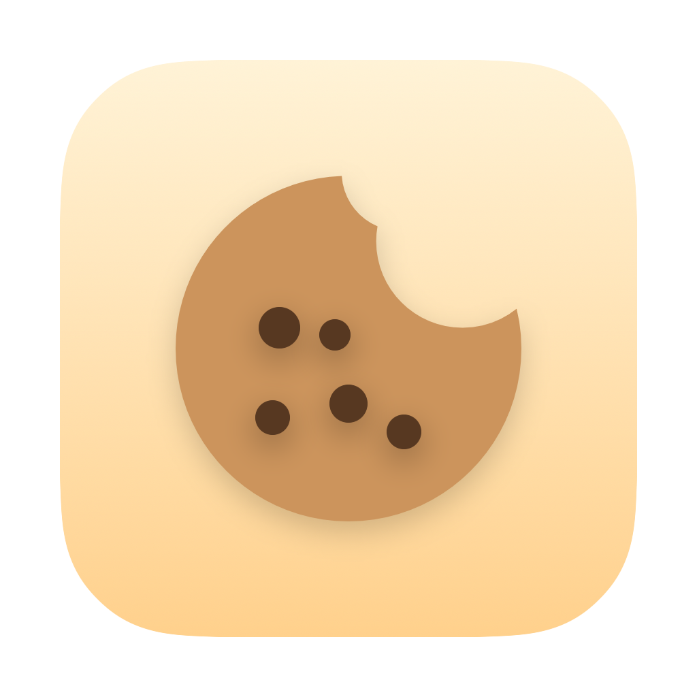

<div align="center">
  
  <h1>Crumble 🍪</h1>
  <p><b>오늘 한 일이 부스러기처럼 남아요.</b></p>
</div>

---

**Crumble**은 내가 **어떤 앱으로 무슨 일을 했는지** 하루 동안 자동으로 기록하는 맥 메뉴바 앱이에요.
타이머를 켤 필요 없이, 지금 쓰는 앱을 알아서 따라가며 일한 시간을 **빵 부스러기처럼 차곡차곡** 모아둡니다.
하루가 끝나면 "오늘 내가 뭘 했지?"에 부스러기들이 대신 답해줘요. 작은 친구 **Workie**가 함께합니다.

> *Crumble quietly tracks what you actually worked on — no timers to start. It follows whichever app is
> in front and gathers your time like breadcrumbs, so at the end of the day you can see where it all went.*

## 주요 기능

- 🍪 **자동 기록** — 최전면 앱(frontmost)을 따라가며 작업 시간을 자동 누적. 타이머 불필요
- 💤 **유휴 감지** — 일정 시간(기본 2분) 입력이 없거나 화면 잠금/슬립이면 측정 일시정지
- 🗂 **카테고리** — 앱을 편집 작업·업무·AI 툴 등으로 그룹화 (직접 추가/수정/삭제)
- 🎯 **목표 + 축하** — 앱별 목표 시간 설정, 달성 시 컨페티·트로피 등 5가지 랜덤 연출 + 알림
- 📊 **통계** — 주간/월간 차트 + 카테고리 분해, CSV 내보내기(하루·앱별 tidy)
- 🪶 **가벼움** — 평소 CPU ≈ 0%, 메모리 ~15MB (팝오버 닫힘 시 갱신 중단)

## 설치

터미널에 아래 한 줄을 붙여넣으면 최신 버전이 응용 프로그램에 설치되고 바로 실행돼요
(Gatekeeper 경고 없음). macOS 14 이상, Apple Silicon·Intel 모두 지원.

```sh
curl -fsSL https://raw.githubusercontent.com/zzanggi-haki/crumble/main/scripts/install.sh | bash
```

수동 설치는 [Releases](https://github.com/zzanggi-haki/crumble/releases)에서 `Crumble.dmg`를
받아 응용 프로그램으로 드래그한 뒤, 첫 실행 시 **시스템 설정 → 개인정보 보호 및 보안 → 그래도 열기**.

## 빌드 방법

[xcodegen](https://github.com/yonyz/XcodeGen)으로 `project.yml`에서 Xcode 프로젝트를 생성합니다.
(`.xcodeproj`는 커밋하지 않으니 먼저 생성해야 합니다.)

```bash
brew install xcodegen          # 최초 1회
xcodegen generate              # project.yml → MyWorkTracker.xcodeproj

# 풀 Xcode 지정 후 빌드
export DEVELOPER_DIR=/Applications/Xcode.app/Contents/Developer
xcodebuild -project MyWorkTracker.xcodeproj -scheme MyWorkTracker -configuration Release \
  -derivedDataPath build CODE_SIGN_IDENTITY="-" CODE_SIGNING_ALLOWED=YES build

# 알림이 동작하려면 /Applications에 설치 후 실행
cp -R build/Build/Products/Release/Crumble.app /Applications/Crumble.app
open /Applications/Crumble.app
```

테스트:

```bash
xcodebuild -project MyWorkTracker.xcodeproj -scheme MyWorkTracker \
  -destination 'platform=macOS' CODE_SIGNING_ALLOWED=NO test
```

## 릴리스

```sh
./scripts/release.sh v1.2.3 --notes-file notes.md
```

DMG 빌드 → GitHub 릴리스 생성 → [Snackbar](https://github.com/zzanggi-haki/snackbar) 사이트 갱신 신호까지 한 번에 한다.
릴리스 노트 첫 문단이 사이트 "최근 업데이트"에 요약으로 실린다. 웹에서 직접 릴리스를 만들면
신호가 안 가니 이 스크립트를 쓴다.

## 기술

- **Swift + SwiftUI** (`MenuBarExtra`, `LSUIElement` 메뉴바 전용 앱), macOS 14+
- 권한 불필요한 API만 사용 — `NSWorkspace`(최전면 앱·슬립/잠금), `CGEventSource`(유휴 감지)
- 데이터: 날짜별 JSON (`~/Library/Application Support/MyWorkTracker/`), 설정에서 폴더 변경 가능
- 측정 핵심 로직은 `SessionMath.swift`로 분리해 단위 테스트로 검증

## 데이터

- 작업 기록은 **전부 로컬에만** 저장돼요. 외부로 전송하지 않습니다.
- 자기 자신·시스템 프로세스(loginwindow 등)는 추적에서 제외됩니다.

## 라이선스

[MIT](LICENSE)
